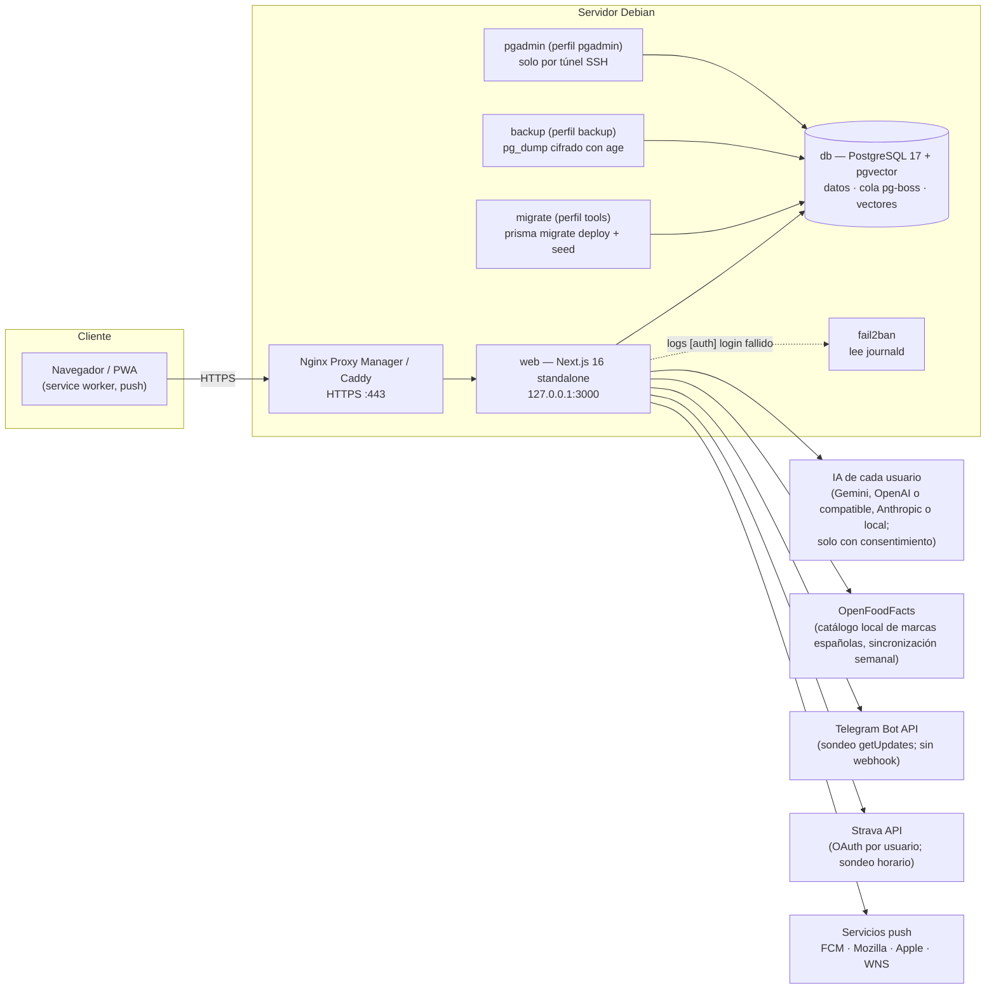
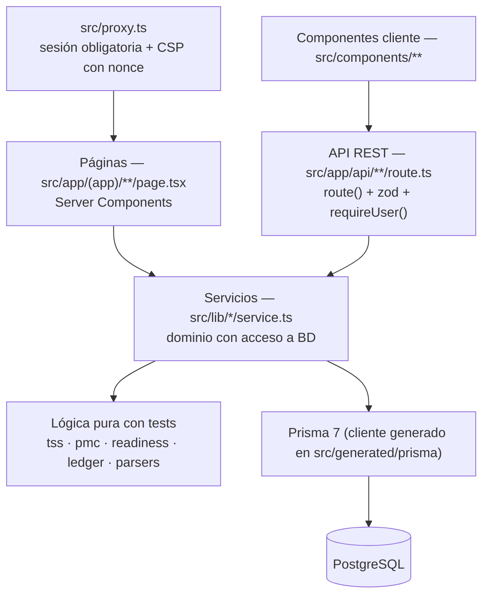
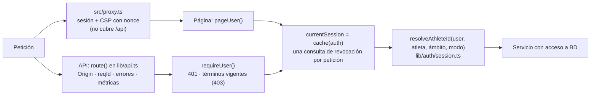

# Atlenza — Arquitectura

Visión de conjunto (revisada en la v2.5.0, 27/10/2026): qué piezas hay, cómo viajan los datos y por qué se tomó cada decisión importante. El detalle (API, fórmulas de carga, RAG) está en [`manual_backend.md`](../manual_backend.md), y el despliegue en [`manual_docker_debian.md`](../manual_docker_debian.md).

## Servicios en producción

`web` lleva todo dentro de un mismo proceso Node:

- las páginas (Server Components) y la API REST;
- el **planificador**: tareas horarias en `src/lib/scheduler.ts`, arrancadas desde `src/instrumentation.ts`;
- el **trabajador de la cola** de ingesta de apuntes (pg-boss sobre la misma PostgreSQL; sin Redis);
- desde la v1.10, el **OCR** con `tesseract` y `pdftoppm`, instalados en la imagen y llamados con `execFile` (`src/lib/files/ocr.ts`).

Todas las conexiones salen de `web`; nada externo llama al servidor salvo la vuelta de OAuth de Strava (`/api/strava/callback`), que pasa por el navegador de la persona.

## Capas del código

- **Leer:** las páginas llaman a los servicios directamente, sin pasar por HTTP.
- **Escribir:** los componentes cliente llaman a la API y después `router.refresh()`.
- **Lógica pura** (sin BD ni red): cálculo de carga, contabilidad, troceado de texto, SM-2 y lectores de ficheros (FIT/GPX/TCX, CSV/Norma 43, plan en PDF). Es lo que más tests tiene.

## Flujos de datos principales

**Registrar una sesión.**

1. `createTrainingSession()` calcula el TSS con los umbrales vigentes ese día.
2. Guarda la cabecera y su detalle (fuerza, técnica o pista) en una transacción.
3. Detecta marcas personales.
4. Rehace la serie PMC (CTL/ATL/TSB/ACWR) desde esa fecha.

**Importar la planificación.**

1. El zip o los PDF llegan en memoria (no se guardan) y se leen con sus coordenadas.
2. El parser saca días, tablas y versiones.
3. Se guardan en `PlanMeso`/`PlanDay`.
4. Solo la versión activa se convierte en sesiones `PLANNED`, ciclos y competiciones.

Reimportar respeta lo ya hecho. Detalle en `manual_backend.md` § 3.1b.

**Apuntes (RAG).**

1. Subida: el documento queda en estado PENDING.
2. La cola pg-boss extrae el texto, lo trocea y crea los embeddings.
3. Se guardan en `DocumentChunk` con un índice HNSW.
4. El chat busca por similitud y cita las fuentes.

**Notificaciones.** El planificador o un evento (por ejemplo, un inicio de sesión nuevo) llama a `sendToUser()`. Este cifra el mensaje (RFC 8291, VAPID) y lo envía solo a los dominios push permitidos (anti-SSRF).

## Seguridad y aislamiento

- **Sesión.** JWT de 7 días (`src/auth.ts`). El callback `jwt` relee al usuario y devuelve `null` si cambió `sessionVersion` o está suspendido o borrado: así se revocan los tokens ya emitidos. `proxy.ts` deja públicas solo `/login`, `/register`, `/reset`, `/offline` y `/legal`; **las rutas `/api` se protegen a sí mismas** (`route()` + `requireUser()`).
- **Roles:** `ATHLETE`, `COACH`, `ADMIN`. El ADMIN global **no** tiene atajo a los datos de nadie: pasa por el mismo vínculo, ámbito y art. 18.
- **Vínculo y ámbitos.**
  - `CoachAthlete` (entrenadora ↔ atleta): `status` PENDING/ACTIVE/REVOKED, `canPlan` y `scopes: CoachScope[]`.
  - Ámbitos `CoachScope`: `LOAD`, `SESSIONS`, `RECOVERY`, `PLANNING`, `REPORTS`.
  - Los clubs dan acceso por `OrgMember` (también con `scopes` y `canPlan`); `mergeGrants()` une los permisos del vínculo 1:1 y de los clubs.
  - `resolveAthleteId()` es **la única puerta** para leer o escribir datos de otra persona: exige vínculo/club ACTIVE, que no haya limitación (art. 18), el ámbito pedido y, para escribir, `canPlan`. `readableScopes()` es la versión por lotes del panel del club.
  - **Finanzas y Estudio nunca se comparten** por este camino.
- **Privacidad.**
  - Art. 18: `User.processingRestrictedAt` (`assertNotRestricted` en `lib/privacy/service.ts`), comprobado también en la IA y en la vista de la entrenadora.
  - Strava: `lib/strava/policy.ts` (`notFromStrava`, `visibleTo`): lo importado de Strava solo lo ve su dueña, y no va a la IA, al `.ics` ni a la entrenadora.
  - Salud cifrada (ciclo, mujer, `HealthLog`): AES-256-GCM (`lib/security/secret-box.ts`, `data-key.ts`, rotación con `DATA_ENCRYPTION_KEY_PREVIOUS`); nunca va a la IA.
- **Abuso y rastro.** `rate-limit-db.ts` (persistente, tabla `RateLimitHit`) con `rate-limit.ts` como respaldo en memoria; `login-guard.ts` (fallos por email+IP, cookie de dispositivo firmada, retraso progresivo); auditoría encadenada `SecurityEvent` (HMAC + `pg_advisory_xact_lock` por usuario); `lib/log.ts` con lista blanca y `scrubText`.
- **Enlaces públicos** (informe, `.ics`, informe de salud): token de 32 bytes, solo se guarda el hash.

**Reglas para una ruta nueva:** (1) `route()` + `requireUser()`; (2) si toca datos de otra persona, `resolveAthleteId` con el ámbito mínimo; (3) si lee sesiones de otra persona, `notFromStrava` y alta en `strava/privacy.int.test.ts`; (4) nada de salud cifrada a la IA; (5) nada escribe en el plan sin borrador y confirmación.

## Trabajo en segundo plano

- `src/instrumentation.ts` arranca (solo runtime Node y con `DATABASE_URL`) el planificador y el trabajador de ingesta.
- **pg-boss** (`lib/jobs/queue.ts`): esquema `pgboss` en la misma BD y **una sola cola**, `ingest-document` (reintentos 2, caducidad 15 min, `batchSize` 1; `singletonKey` = id del documento). Extrae, trocea y calcula los embeddings de los apuntes.
- **Planificador** (`lib/scheduler.ts`): **no es pg-boss**, es `setInterval`. Tick horario (limpieza, resumen, recordatorios, citas, plazos, suscripciones, entrenadora, Strava, catálogo), `safetyTick` cada 5 min (seguridad, métricas, vigilancia) y Telegram cada 30 s. `SCHEDULER_ENABLED=false` lo apaga.
- **Varias réplicas:** cada trabajo va dentro de `withJobLock` (`lib/job-lock.ts`, `pg_try_advisory_lock` en un `Pool` propio): si otra réplica lo tiene, no se ejecuta.

## Módulos principales

| Módulo | Páginas (`src/app/(app)/`) | API | Servicios clave |
|---|---|---|---|
| **Entreno** | `training`, `planning`, `coach` | `/api/training`, `/api/planning`, `/api/coach`, `/api/ai-plan`, `/api/routine` | `training/service.ts` (`createTrainingSession`, `recomputeDailyLoads`), `planning/plan-import`, `ai-plan/service.ts`, `routine/service.ts`, `coach/overview.ts`, `coach/multi-plan.ts`, `clubs/` |
| **Salud** (recuperación, nutrición) | `recovery` (incluye `health`, `women`, `fisio`, `wellbeing`), `nutrition` | `/api/recovery`, `/api/health`, `/api/nutrition` | `health/cycle-service.ts`, `women-service.ts`, `recovery/*` (`refreshReadiness` vive en `training/service.ts`), `nutrition/service.ts`, `catalog-sync.ts` |
| **Finanzas** | `finance` (`/`, `budgets`, `history`, `more`, `trips`) | `/api/finance` | `finance/ledger.ts` (partida doble), `balances.ts` (`moneySummary`), `budgets-service.ts`, `bank-import-service.ts`, `service.ts` |
| **Estudio** | `study` (pestañas y `modules/[id]`: test, quest) | `/api/study`, `/api/ai/study/*`, `/api/ai/{documents,flashcards,ask}` | `ai/rag.ts` (ingesta y búsqueda), `study/modules-service.ts`, `study/quest*.ts`, `study/self-test.ts`, `study/practical-manual.ts` + `pdf-render.ts`, `study/quota.ts` |

Escala (27/10/2026): 125 modelos Prisma, 252 rutas `route.ts` y 88 páginas.

**Datos de cada módulo**
- **Entreno:** una sesión guarda cabecera + detalle (fuerza, técnica, pista) → `DailyLoad` (PMC) se rehace desde esa fecha → `refreshReadiness`. Los vínculos de la entrenadora pasan siempre por `resolveAthleteId`.
- **Salud:** el ciclo y la salud de la mujer van cifrados en la columna `data`; `RecoveryMetrics` alimenta el readiness (línea base de 60 días).
- **Finanzas:** cada movimiento son `Posting` que suman 0 (trigger `posting_balanced`); **los saldos se suman al leer** (`groupBy`/`$queryRaw`), no hay columna de saldo. Los presupuestos mensuales se versionan con `endDate`.
- **Estudio:** `StudyDocument` → cola → `DocumentChunk` (+ vector HNSW). Sobre el RAG (`searchChunks`/`sampleChunks`) cuelgan resumir/TDAH, micro-pasos, «Evaluar nivel», el Modo Juego y el manual en PDF. Las rutas de IA **no escriben** salvo al guardar de forma explícita; la corrección del Modo Juego es 100 % local.

## Decisiones de diseño

| Decisión | Por qué |
|---|---|
| **Finanzas en partida doble** (`posting_balanced`, un trigger en la BD) | Cada movimiento suma 0 entre sus líneas: el saldo no puede descuadrarse ni por un fallo de la app. |
| **PMC persistida por día** (`DailyLoad`) | Las gráficas y el readiness no recalculan años de sesiones en cada visita; se rehace solo desde la fecha que cambió. |
| **Umbrales versionados** (`ThresholdHistory`) | Cambiar el LTHR no reescribe la carga histórica. |
| **Cola en PostgreSQL** (pg-boss) | Reintentos y trabajo en segundo plano sin añadir Redis a un servidor casero. |
| **Sesiones JWT revocables** (`sessionVersion`) | Cambiar la contraseña o «cerrar sesión en todos» invalida los tokens ya emitidos. |
| **CSP con nonce por petición** (`src/proxy.ts`) | Sin `unsafe-inline` en los scripts: una inyección de HTML no ejecuta código. |
| **2FA TOTP con anti-reutilización** y secretos cifrados (AES-256-GCM) | Un volcado de la BD no basta para generar códigos, y un código ya usado no vale dos veces. |
| **Límites de intentos en la BD** (`RateLimitHit`, con respaldo en memoria) | Valen con varias réplicas y sobreviven a un reinicio; el de memoria queda solo como respaldo. |
| **Plan importado en tablas propias**, no como sesiones ocultas | Las versiones no elegidas no deben contar como día de entreno en nutrición, en el coach IA ni en los listados. |
| **Migraciones solo aditivas** | `update.sh` puede volver a la imagen anterior sin tocar la BD: la versión anterior funciona con el esquema nuevo. |
| **Copias cifradas con clave pública** (age) | El servidor no puede leer sus propias copias: si lo roban, las copias no sirven. |
| **Datos del ciclo cifrados y fuera de la IA** | Dato de salud de categoría especial: AES-256-GCM en la BD, la IA solo genera una «versión suave» genérica y la app decide en local cuándo proponerla. |
| **Enlaces públicos con token, no cuentas para terceros** | El .ics y el informe para la entrenadora funcionan sin cuenta: token de 32 bytes con hash en la BD, caducidad o revocación, límite por IP y contenido mínimo. |
| **Umbrales en «Mis reglas», no en el código** | El repositorio es público: ningún dato personal (peso, RM) se fija en el código; vienen valores genéricos editables. |
| **Repositorio público sin datos personales** | Tests con datos sintéticos (PDF y FIT generados en el propio test); los datos reales solo entran por la app. Ver [`SECURITY.md`](../SECURITY.md). |

## Dónde está cada cosa

| Ruta | Contenido |
|---|---|
| `src/lib/training/` | Motor de carga, importar del reloj, plantillas, temporizador, tabla de RM y %RM → kg, registrar desde el plan, 3 mejores por implemento; v1.6: kg del día (`autoreg.ts`), análisis de jabalina, temporadas, prehab y fatiga por zona; v1.7: diario técnico, comparador, simulador de intentos, combinadas, récords por categoría e importar calendario (`competition-tools.ts`) |
| `src/lib/planning/` | Agenda del calendario, `plan-import/` (lector de PDF, versiones, servicio), cumplimiento, competición y calendario .ics; v1.6: afinamiento, recolocar y semanas tipo (sugerencias que no tocan el plan sin confirmar) |
| `src/lib/ai-plan/` · `src/lib/routine/` | Crear planificación con IA: cuestionario, prompt, validación, expansión a días, ajustes y seguimiento · v1.7: rutina del cuestionario sin IA (perfil, PAR-Q, generador y proyección de progreso) |
| `src/lib/rules/` | «Mis reglas»: preferencias y motor de avisos (control rápido, peso, VFC, lanzamientos, vídeo, sensaciones) y semáforo del día |
| `src/lib/health/` | Ciclo menstrual y salud de la mujer (cifrado), patrón y predicción aprendida, salud ósea, anticoncepción y menopausia, enlaces para médica, fisio e informe anual, «entreno sola» |
| `src/lib/report/` | Informe de solo lectura para la entrenadora |
| `src/lib/finance/` | Contabilidad, presupuestos, importar extractos, viajes de competición y plazos; v1.7: presupuesto de temporada, justificantes y subidas de precio; v2.5: `balances.ts`, `budgets-service.ts`, historial editable y selector de cuenta |
| `src/lib/ai/` | Proveedores de IA por usuario (`provider.ts`, `credentials.ts`), RAG, flashcards, coach semanal |
| `src/lib/clubs/` · `src/lib/coach/` · `src/lib/log.ts` | Clubs y cuotas, panel del club · panel de la entrenadora, varias atletas y «qué pasa si» · registro JSON con lista blanca |
| `src/lib/security/` · `src/lib/auth/` · `src/lib/privacy/` · `src/lib/files/` | 2FA, auditoría encadenada, cifrado y rotación de claves, CSP · sesión, permisos del coach, Argon2id y llaves de acceso · consentimientos, derechos, limitación y conservación · ficheros cifrados (fotos y justificantes) |
| `src/lib/push/` · `src/lib/jobs/` · `src/lib/scheduler.ts` | Notificaciones (push y, desde la v1.10, Telegram) · cola · tareas programadas |
| `src/lib/telegram/` · `src/lib/strava/` | v1.10 · Vincular Telegram con código y sondeo del bot · OAuth, sincronización y la política que deja fuera de la IA y del coach lo que llega de Strava (`policy.ts`) |
| `prisma/` | Esquema, migraciones, seed y `scripts/user-admin.ts` |
| `deploy/` · `scripts/update.sh` | Copias, fail2ban · actualizar con vuelta atrás |
| `src/lib/recovery/` · `src/lib/nutrition/` · `src/lib/study/` | Readiness, importaciones (CSV, Apple Health), antropometría, citas y suplementos, bienestar y fotos de lesión · OpenFoodFacts y catálogo local, micronutrientes, foto de la comida y plan con IA (v1.10), agua, cocina (recetas, compra, comida de competición, plan semanal), sudoración y calendario de suplementos · horario, pomodoro, hábitos, plan hasta el examen, notas, tarjetas a mano, trabajos y franjas; v2.5: asignaturas y ruta (`modules-service.ts`), resumen TDAH, micro-pasos, cuota, «Evaluar nivel», Modo Juego (`quest*.ts`) y manual PDF (`practical-manual.ts`, `pdf-render.ts`) |
| `src/lib/offline/` · `src/lib/account/` · `src/lib/demo/` | Bandeja sin conexión (IndexedDB: sesiones, agua, hábitos y comidas) · exportar, restaurar y borrar la cuenta · cuentas demo con datos sintéticos |
| `src/lib/goals/` · `src/lib/review/` · `src/lib/admin/` | v1.8 · Objetivos (progreso puro + servicio) · revisión semanal · uso local, errores del servidor, integridad, aviso de copias y de versión nueva |
| `src/lib/share*.ts` · `public/sw.js` | v1.8 · Compartir con Atlenza: el service worker guarda lo compartido en Cache Storage y `/share` propone el destino |
| `e2e/` | Recorridos en Chromium: uso diario, seguridad, importar el plan y de la v1.4 a la v1.10 (con axe en `e2e/a11y.mts`) |

## Auditoría de rendimiento (27/10/2026)

Auditoría **estática** (lectura del código, sin medir): los impactos son estimaciones por forma de la consulta, no tiempos. **Resueltos en Optimización B1 (marcados ✅):** O1, O2, O6, O7, O8 (objetivos/material), O12; el resto sigue sin corregir; el plan de ataque resumido está en [`estado.md`](estado.md) § Plan de Optimización. Los IDs `O1…` son los mismos en ambos documentos. Antes de arreglar cada uno hay que **medir** (contar consultas como en el B5 de la v2.5; TTFB en `ttfb-v2-4.md`).

### Fase 1 · Backend de alto impacto
| ID | Dónde | Problema | Arreglo propuesto |
|---|---|---|---|
| O1 ✅ | `lib/ai/rag.ts:190-194` | Un `UPDATE` por chunk (en serie, dentro de una transacción de 120 s). Un libro de 15 MB son ~13 000 chunks: miles de idas y vueltas y riesgo de caducar. | Una sola sentencia `UPDATE … FROM unnest(ids, vectores)`; igual para el `createMany` previo. |
| O2 ✅ | `lib/ai/rag.ts:229-236` | La búsqueda filtra por `userId` y `embedModel` **después** del índice HNSW global; sin `hnsw.iterative_scan` (no figura en el repo) con muchas usuarias puede devolver menos de *k* resultados o ninguno. | En transacción: `SET LOCAL hnsw.iterative_scan = relaxed_order` (y `ef_search`); o copiar `embedModel` a `DocumentChunk` para quitar el `JOIN`. |
| O3 | `lib/ai/provider.ts:175-211` | El SDK de Gemini (`generateContent`, `embedContent`) no tiene tiempo límite; `postJson` sí (90 s). Una llamada colgada bloquea la petición o el único trabajador de ingesta hasta 15 min. | `httpOptions.timeout` / señal de aborto en el SDK. |
| O4 | `account/restore.ts:96-103`, `strava/service.ts:128-140`, `recovery/hrv-import-service.ts:24-32`, `training/service.ts:446-527` | Cada sesión creada rehace la serie de carga desde su fecha hasta hoy y luego `refreshReadiness` **día a día** (3 lecturas + 1 escritura por día, releyendo 60 días de base). Restaurar, importar Strava o un CSV de VFC multiplica sesiones × días. | Parámetro «sin recalcular» en el bucle y **un solo** recálculo desde la fecha más antigua; `refreshReadiness` en lote (leer todo una vez, calcular en memoria, escribir en bloque); upsert masivo en la VFC. |
| O5 | `finance/bank-import-service.ts:79-97` | `createTransaction` por cada línea del extracto: ~6 consultas por línea (cuentas por defecto, recuentos, creación anidada); los duplicados se detectan capturando P2002. | Resolver cuentas y propiedad una vez, prefiltrar hashes (como ya hace `previewStatement`) y crear en lote en una `$transaction`. |

### Fase 2 · Portada y vistas de uso diario
| ID | Dónde | Problema | Arreglo propuesto |
|---|---|---|---|
| O6 ✅ | `ai/flashcards.ts:132-140` (`dueCounts`, portada) | Carga **todas** las tarjetas visibles con su repaso solo para contar las pendientes. | `COUNT` en SQL con `LEFT JOIN` a `FlashcardReview`, agrupado por mazo (existe el índice `(userId, dueAt)`). |
| O7 ✅ | `finance/service.ts:303-311` (`budgetsStatus`, portada) | Un `posting.aggregate` con 3 tablas por cada presupuesto activo. | Un `groupBy` por ventana de periodo, como ya hace `monthlyBudgetView` (`budgets-service.ts:26`). |
| O8 ✅ (parcial: objetivos y material) | `goals/service.ts:43-48`, `training/equipment-service.ts:17-47`, `scheduler.ts:154-158` | Una consulta por objetivo (hasta 50, también los terminados) y por material (incluido el retirado); el resumen diario reexplora cada hora a quien no tiene nada que avisar. | Calcular solo lo abierto, agrupar por tipo y guardar la clave `digest:` aunque no haya aviso. |
| O9 | `components/study/documents-panel.tsx:51-55` + `app/(app)/study/(index)/page.tsx:32-45` | Mientras un apunte está PENDING/PROCESSING se hace `router.refresh()` **cada 3 s**: cada vez se ejecutan `aiAvailable` + 7 consultas (incluida la suma de cuota) de las 8 pestañas. | Sondear un endpoint pequeño de estado y refrescar solo si cambia; cargar los datos por pestaña (`?tab=` ya se lee). |

### Fase 3 · Índices (irían en la migración de la versión siguiente; solo aditivos)
La migración `v2_5_features` ya añadió `@@index([userId])` en nueve modelos (StudyModule, StudyTopic, CalendarFeed, HabitLog, PlanFeedback, PrehabLog, ReturnProtocol, RoutineTest, SharedReport) más `StudyTopic(moduleId)` y `StudyDocument(moduleId)`. Quedan sin cubrir:

| ID | Modelo / consulta | Índice |
|---|---|---|
| O10 | `SessionComment`: `athleteId IN` (`coach/overview.ts:26`), `athleteId OR authorId` (`account/service.ts:169`) | `@@index([athleteId])`, `@@index([authorId])` |
| O11 | `SecurityEvent` / `NotificationLog`: limpieza horaria por fecha (`scheduler.ts:95-96`) hoy recorre la tabla entera | `@@index([createdAt])`, `@@index([sentAt])` |
| O12 ✅ | `DocumentChunk`: `to_tsvector('spanish', content)` calculado por fila en cada consulta (`rag.ts:240-248`), sin GIN | Columna generada `tsv` + índice GIN |
| O13 | `FoodProduct`: `contains` insensible (`ILIKE '%w%'`, `nutrition/service.ts:44-49`) que los btree no sirven | `pg_trgm` GIN en `name` y `brand` (requiere la extensión) |
| O14 | `PersonalRecord` (`training/service.ts:345,366`), `TrashItem(deletedAt)`, `TrainingCycle(parentId)`, `FinancialTransaction(tripId/subscriptionId)`, `Subscription(accountId)`, `TrainingSession(userId, startedAt)` | Uno por consulta; prioridad baja |

### Fase 4 · Menores y de frontend
| ID | Dónde | Nota |
|---|---|---|
| O15 | `components/study/micro-steps-panel.tsx:93-105` | Un `setInterval` de 1 s hace `setNow` en un componente padre de ~260 líneas: todo el panel se repinta cada segundo. Mover la cuenta atrás a un hijo `<Countdown>` que posea el intervalo (`pomodoro.tsx:89` y `rest-timer.tsx:134`, 250 ms, son más pequeños). |
| O16 | ~162 `router.refresh()` en ~50 componentes | Cada mutación vuelve a pedir el árbol de la página. Revalidación dirigida u estado local optimista para cambios pequeños. |
| O17 | `study/pdf-render.ts:11-44` | Una cola global: un PDF a la vez para todas, y el manual de 4 pasadas se intercala con los de otras. Pool de 2–3 contextos y pasadas del mismo manual juntas; `doc.destroy()` en `pageTexts`. |
| O18 | `ai/llm.ts:20-43`, `guard.ts:13-15`, `rag.ts:280-303` | Cada llamada a la IA relee y descifra la credencial (`askStudyQuestion`: 3 lecturas, 2 descifrados). Resolver el cliente una vez por petición. |
| O19 | `rag.ts:227`→`240`, `provider.ts:206-211` | La búsqueda por texto espera al embedding aunque solo necesita la etiqueta (`Promise.all`); los lotes de 100 embeddings van en serie (concurrencia 2–4). |
| O20 | `study-quest.ts:23-36`, `flashcards.ts:43-50`, `study-adapt.ts:64-70` | Cargan todos los chunks para quedarse con una muestra (`sampleChunks`); muestrear en SQL. |
| O21 | `admin/metrics.ts:98-106` | `flushMetrics` (cada 5 min) hace un upsert por (minuto, ruta) de toda la ventana de 60 min aunque no haya cambiado. Volcar solo lo modificado, en un `INSERT … ON CONFLICT`. |
| O22 | `training/implement-bests-query.ts:13`, `finance/service.ts:442-469`, `trips-service.ts:13-20`, `season-service.ts:23-27` | Cargan todo el histórico (sin `take`) y suman en JS; usar `ROW_NUMBER()` / `groupBy` por transacción. `listAccounts` recorre todos los apuntes de la usuaria en cada visita a `/finance` (aceptable hoy; valorar columna de saldo en caché si crece). |
| O23 | `planning/plan-import/service.ts:226-270`, `planning/manual-plan.ts:131-203`, `coach/multi-plan.ts:104-125` | Reescriben todos los días aunque cambie uno; ~10 consultas por atleta en serie (agrupar con `userId IN (…)` como `club-panel.ts`). |
| O24 | Sin caché de prompts | Los prompts de sistema fijos se reenvían enteros; la ruta Anthropic no usa `cache_control`. |
| O25 | `rag.ts:59-64`, `queue.ts:68` | `assertQuota` comprueba y luego inserta sin bloqueo (subidas paralelas pueden pasarse del tope); la ingesta es de una en una para todo el servidor (`localConcurrency` 2 o límite por usuaria). |

**Sin hallazgo:** los gráficos ya cargan con `next/dynamic` (`components/charts/lazy.tsx`); Playwright y `unpdf` son solo de servidor; no hay *context providers* con `value={{…}}`; los saldos de cuentas y el flujo de caja ya se agregan en SQL.
